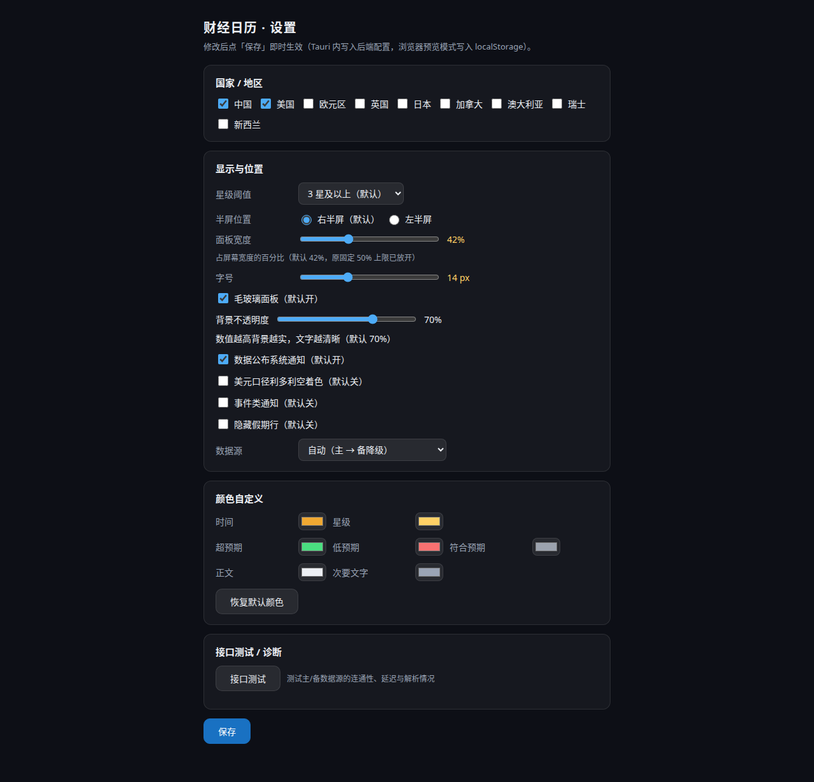
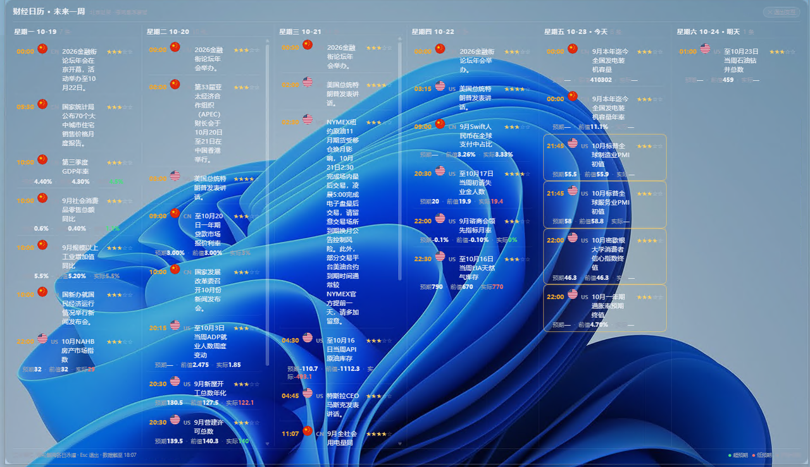

# 📅 桌面财经日历挂件

**把未来一周的财经大事，直接"贴"在你的桌面壁纸上。**

> 如果这个项目对你有帮助，欢迎点右上角的 ⭐ **Star** 支持一下！你的 Star 是我持续更新的最大动力。

---

## 为什么你需要它？

做美股、期货、外汇交易，最怕的就是**错过关键数据**：非农、CPI、议息决议……这些数字一公布，行情可能瞬间波动几个百分点。

但现实是：财经网站要主动打开才看得到，手机 App 的推送要么延迟要么被淹没在消息堆里，等你想起来查，日内最重要的行情已经走完了。

这个挂件就是为解决这个痛点而生的：**它像一层透明薄膜一样浮在你的壁纸上，右半屏静静展示未来一周所有重要财经事件**——不用打开任何软件，余光一扫就知道今晚有什么大事。

## 它能帮你做什么？

- 👀 **一眼掌握本周大事**：非农、CPI、央行决议……按天分组，重要程度用星级标好，3 星以下自动过滤不打扰你
- ⏰ **再也不用算时差**：所有时间自动换算成北京时间，美东夏冬令时切换不用你操心
- 📊 **数据一公布就看到结果**：预期值 / 前值 / 实际值三栏对照，超预期标绿、低预期标红，一目了然
- 🔔 **重要数据公布时弹窗提醒**：盯盘时不用分心去刷手机
- 🪟 **完全不打扰你干活**：透明叠加在壁纸上不替换壁纸，鼠标直接点穿（点不中、挡不住），桌面图标该在哪还在哪
- 🔍 **想细看时随时能翻**：托盘点「交互浏览」即切换为按天分列的泳道模式，每列可独立滚轮翻阅，再长的事件也看得全；Esc 一键退出，立刻回到穿透壁纸形态
- 🎨 **长得好看还能调**：毛玻璃面板、7 处颜色自定义、面板宽度、左右半屏、字号，随你调
- 🪶 **轻到忘记它在运行**：事件驱动刷新（只在数据公布前后唤醒），不轮询、不占资源，开机自启、托盘常驻
- 🌍 **多市场覆盖**：默认中美，可加选欧元区、英国、日本等；数据源故障自动降级，断网也有本地缓存兜底

## 适合谁？

- 做美股 / 期货 / 外汇 / 黄金原油的交易者
- 需要跟踪宏观数据、央行动态的投资者
- 讨厌开一堆网页查日历，想要桌面一眼可见的人

## 效果图






> **交互浏览模式**：平时挂件完全穿透、只做壁纸；想翻看某一天的全部事件时，从托盘点「交互浏览」，面板会按天分成并排泳道，每列都能用滚轮独立翻阅（上图周三一列就是一条很长的事件公告全文）。看完按 Esc 或再点托盘，立即回到穿透形态。

## 下载安装

### Windows

1. 打开本仓库的 [**Releases**](https://github.com/sslzhou948/fin-calendar-widget/releases) 页面
2. 下载最新版的 `FinCalendarWidget_*.exe`（安装向导，推荐）或 `*.msi`
3. 双击运行安装

> **关于 Windows 的安全提示（请放心放过）**：本项目是开源软件，全部代码公开可查，本身是安全的。目前暂未做代码签名，Windows SmartScreen 对**所有**未签名软件都会统一弹出"Windows 已保护你的电脑"提示——这只是"发布者未验证"的提醒，不是病毒警告。点提示里的**"更多信息" → "仍要运行"**即可正常安装。
4. 安装完成后挂件自动出现在主屏右半屏，托盘区有图标可进设置

### macOS

1. 在 [**Releases**](https://github.com/sslzhou948/fin-calendar-widget/releases) 页面下载最新版的 `*.dmg`
2. 拖入"应用程序"文件夹即可

> **找不到 Releases？** 说明正式版还在构建中，也可以去 [Actions](https://github.com/sslzhou948/fin-calendar-widget/actions) 找最新一次成功的构建，在页面底部 Artifacts 栏下载安装包。

## 喜欢它？请给个 Star ⭐

这个项目是业余时间独立开发的，没有团队、没有推广预算。**你的每一个 Star 都是实实在在的鼓励**，也会让更多交易者发现它。

- 觉得好用 → 点个 ⭐ Star
- 有想法 / 遇到 Bug → 提个 [Issue](https://github.com/sslzhou948/fin-calendar-widget/issues)
- 会写代码 → 欢迎 PR

---

<details>
<summary>开发者信息（点击展开）</summary>

- 技术栈：Tauri v2（Rust + 系统 WebView），一套代码编 Windows / macOS
- 刷新机制：事件驱动，零轮询 —— 每周一 10:00（北京时间）全量 + 开机/唤醒对账补拉 + 公布后约 2 分钟唤醒更新实际值
- 显示：全部北京时间；三类行（数据行三栏 / 事件行紧凑单行 / 假期行淡化）；中性着色；圆形国旗 + 国家缩写；默认纯点击穿透，可从托盘切「交互浏览」（按天泳道、独立滚动、Esc 退出）

```bash
npm install
npx tauri dev      # 调试运行
npx tauri build    # 打安装包（Windows: msi/nsis；macOS: dmg）
```

云构建：`.github/workflows/build.yml`（需手动上传，见文件头注释）。push tag `v*` 后在 Windows / macOS 云主机自动构建并发布 draft Release。

详细需求见 [`PRD.md`](./PRD.md)，技术方案见 [`docs/TECH-DESIGN.md`](./docs/TECH-DESIGN.md)。

</details>
